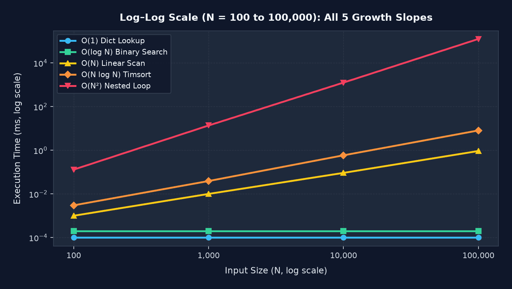


[Big-O notation](https://en.wikipedia.org/wiki/Big_O_notation) describes how an algorithm's execution time or memory footprint scales as the input size ($N$) grows, rather than measuring raw wall-clock seconds.
Understanding these growth rates helps you spot code that runs effortlessly on 100 test records but grinds production to a halt at 100,000 records.

- **$O(1)$ and $O(\log N)$ scale effortlessly:** [Hash table](https://en.wikipedia.org/wiki/Hash_table) lookups (`dict`, `set`) and [binary search](https://en.wikipedia.org/wiki/Binary_search) barely flinch even as datasets grow into the millions.
- **$O(N)$ and $O(N \log N)$ are the everyday workhorses:** Single-pass loops and comparison-based sorting algorithms like [Timsort](https://en.wikipedia.org/wiki/Timsort) scale predictably for standard application workloads.
- **Beware the $O(N^2)$ quadratic wall:** Nested loops (or hidden linear scans like `item in my_list` inside a loop) quadruple their runtime every time the input size doubles.
- **Replace nested scans with sets:** Swapping an inner list lookup for a Python [`set`](https://docs.python.org/3/library/stdtypes.html#set) or [`dict`](https://docs.python.org/3/library/stdtypes.html#dict) routinely collapses $O(N^2)$ bottlenecks down to $O(N)$.


Every developer has shipped a feature that runs instantaneously in local tests with 50 records, only to watch it time out in production when handed 50,000 records.
The hardware didn't get slower; the algorithm hit a scaling curve.

[Big-O notation](https://en.wikipedia.org/wiki/Big_O_notation) gives you the vocabulary to predict that curve before your code ever reaches production.
Rather than measuring execution in milliseconds (which varies by CPU, language, and background load), Big-O measures how the number of operations grows relative to the input size, $N$.

In recent posts on [Implementing a Cache from Scratch]() and [Rate Limiting and Throttling](), I emphasised keeping hot-path operations at $O(1)$.
In this shorter guide, I break down the five core complexity classes you'll encounter in everyday software engineering, show what each looks like in [Python](https://www.python.org/), and provide a benchmark script so you can watch the scaling curves diverge firsthand.

## Why Should You Care About Big-O?

Big-O notation expresses the [asymptotic upper bound](https://en.wikipedia.org/wiki/Asymptotic_analysis) (worst-case growth rate) of an algorithm's **time complexity** (CPU operations) or **space complexity** (memory usage).
When evaluating Big-O, you drop constant factors and lower-order terms because the highest-order term completely dominates as $N$ grows large.

Hardware cannot rescue a poor growth rate.
When $N = 100$, an $O(N)$ algorithm performs $100$ operations and an $O(N^2)$ algorithm performs $10,000$ operations, both finishing in a fraction of a millisecond.
Scale $N$ to $100,000$, and the $O(N)$ pass still takes around a millisecond ($100,000$ operations), whereas the $O(N^2)$ routine must churn through $10,000,000,000$ ($10$ billion) operations.

## The Five Core Complexity Classes

### O(1): Constant time

An $O(1)$ algorithm executes in the same amount of time regardless of whether your collection holds ten items or ten million.
Array index lookups (`items[0]`) and [hash table](https://en.wikipedia.org/wiki/Hash_table) operations on a Python [`dict`](https://docs.python.org/3/library/stdtypes.html#dict) or [`set`](https://docs.python.org/3/library/stdtypes.html#set) run in $O(1)$ average time:

```python
def get_user_email(users_by_id: dict[int, str], user_id: int) -> str | None:
    # Hash computation and bucket lookup take constant time
    return users_by_id.get(user_id)
```

Whether `users_by_id` contains 100 users or 1,000,000 users, Python hashes the key once and jumps directly to the memory slot.

### O(log N): Logarithmic time

An $O(\log N)$ algorithm cuts the remaining problem space in half on every step.
Because $\log_2(1\,000\,000) \approx 20$, searching a sorted list of one million elements with [binary search](https://en.wikipedia.org/wiki/Binary_search) takes at most 20 comparisons.

You can see this halving behaviour directly in a binary search loop, or use Python's standard [`bisect`](https://docs.python.org/3/library/bisect.html) module:

```python
import bisect


def binary_search(sorted_items: list[int], target: int) -> int:
    # Halves the search interval on each comparison: O(log N)
    idx = bisect.bisect_left(sorted_items, target)
    if idx < len(sorted_items) and sorted_items[idx] == target:
        return idx
    return -1
```

Doubling the dataset from one million to two million items adds just **one** extra comparison.
This logarithmic property is why database [B-tree](https://en.wikipedia.org/wiki/B-tree) indexes remain fast at massive scale.

### O(N): Linear time

An $O(N)$ algorithm examines each element a constant number of times, meaning runtime grows in direct 1:1 proportion to the input size.
Double the input, and you double the execution time:

```python
def contains_value(items: list[int], target: int) -> bool:
    # In the worst case, inspects every element once: O(N)
    for item in items:
        if item == target:
            return True
    return False
```

You don't have to write an explicit `for` loop to trigger $O(N)$ work, because many built-in operations iterate over the collection under the hood.
For example, checking `target in my_list` (or calling `max(my_list)` or `sum(my_list)`) looks like a single step, but Python still performs the exact same $O(N)$ linear scan in C, whereas `target in my_set` uses an $O(1)$ hash lookup.

### O(N log N): Linearithmic time

$O(N \log N)$ is the theoretical speed limit for general comparison-based sorting algorithms, such as [Merge Sort](https://en.wikipedia.org/wiki/Merge_sort) and [Timsort](https://en.wikipedia.org/wiki/Timsort) (which powers Python's built-in [`sorted()`](https://docs.python.org/3/library/functions.html#sorted) and `list.sort()`).
It combines dividing the dataset recursively in $\log N$ depth with $O(N)$ work to merge the pieces at each level:

```python
def sort_records(items: list[int]) -> list[int]:
    # Python's Timsort runs in O(N log N) worst-case time
    return sorted(items)
```

While slightly steeper than linear time, $O(N \log N)$ handles hundreds of thousands of elements in milliseconds and is often the fastest way to prepare unsorted data for $O(\log N)$ binary searches.

### O(N²): Quadratic time (and beyond)

An $O(N^2)$ algorithm compares every element against every other element.
When you double the input size ($2N$), the workload quadruples ($4N^2$); multiply the input by $10$, and the workload explodes by $100\times$.

Quadratic complexity almost always stems from nested loops over the same collection, or calling an $O(N)$ helper (like `x in list`) inside an $O(N)$ loop:

```python
def find_duplicates_quadratic(items: list[int]) -> list[int]:
    duplicates: list[int] = []
    n = len(items)
    # Outer loop runs N times; inner loop runs ~(N / 2) times -> O(N²)
    for i in range(n):
        for j in range(i + 1, n):
            if items[i] == items[j]:
                duplicates.append(items[i])
    return duplicates
```

You can almost always eliminate $O(N^2)$ duplicate or membership checks by trading a tiny amount of memory for an $O(1)$ [`set`](https://docs.python.org/3/library/stdtypes.html#set), collapsing the entire function to $O(N)$:

```python
def find_duplicates_linear(items: list[int]) -> list[int]:
    seen: set[int] = set()
    duplicates: list[int] = []
    # Single pass with O(1) set lookups -> O(N) time, O(N) space
    for item in items:
        if item in seen:
            duplicates.append(item)
        else:
            seen.add(item)
    return duplicates
```

Beyond $O(N^2)$ lie **$O(2^N)$ exponential time** (such as naive recursive [Fibonacci](https://en.wikipedia.org/wiki/Fibonacci_sequence) without [memoisation](https://en.wikipedia.org/wiki/Memoization) or generating all subsets) and **$O(N!)$ factorial time** (such as brute-forcing the [Travelling Salesman Problem](https://en.wikipedia.org/wiki/Travelling_salesman_problem)).
Those algorithms become intractable once $N$ passes 30 to 40 items, requiring [dynamic programming](https://en.wikipedia.org/wiki/Dynamic_programming) or heuristic approximations.

## Seeing the Difference: Scaling the Data Size

The clearest way to appreciate Big-O is to watch how each complexity class responds as you dial $N$ up by factors of ten.
Save the following script as `benchmark_big_o.py` and run it locally with [`time.perf_counter()`](https://docs.python.org/3/library/time.html#time.perf_counter):

```python
from __future__ import annotations

import bisect
import random
import time


def constant_lookup(user_map: dict[int, int], target: int) -> int | None:
    return user_map.get(target)


def binary_search(sorted_items: list[int], target: int) -> int:
    idx = bisect.bisect_left(sorted_items, target)
    if idx < len(sorted_items) and sorted_items[idx] == target:
        return idx
    return -1


def linear_scan(items: list[int], target: int) -> bool:
    for item in items:
        if item == target:
            return True
    return False


def linearithmic_sort(items: list[int]) -> list[int]:
    return sorted(items)


def quadratic_duplicates(items: list[int]) -> list[int]:
    duplicates: list[int] = []
    n = len(items)
    for i in range(n):
        for j in range(i + 1, n):
            if items[i] == items[j]:
                duplicates.append(items[i])
    return duplicates


def measure_ms(func, *args, repeats: int = 1) -> float:
    start = time.perf_counter()
    for _ in range(repeats):
        func(*args)
    elapsed = time.perf_counter() - start
    return (elapsed / repeats) * 1000.0


def run_benchmarks() -> None:
    sizes = [100, 1_000, 10_000, 100_000]
    header = (
        f"{'N':>8} | {'O(1)':>10} | {'O(log N)':>10} | "
        f"{'O(N)':>10} | {'O(N log N)':>12} | {'O(N²)':>12}"
    )
    print(header)
    print("-" * len(header))

    t_on2 = 0.0
    for n in sizes:
        data = list(range(n))
        random.shuffle(data)
        sorted_data = list(range(n))
        lookup_map = {x: x for x in data}
        missing_target = -1

        t_o1 = measure_ms(constant_lookup, lookup_map, missing_target, repeats=1000)
        t_log = measure_ms(binary_search, sorted_data, missing_target, repeats=1000)
        t_on = measure_ms(linear_scan, data, missing_target, repeats=20)
        t_nlogn = measure_ms(linearithmic_sort, data, repeats=5)

        if n <= 10_000:
            t_on2 = measure_ms(quadratic_duplicates, data, repeats=1)
            on2_str = f"{t_on2:.3f} ms"
        else:
            # 10x input on O(N²) scales runtime by ~100x
            on2_str = f"~{t_on2 * 100:.0f} ms*"

        print(
            f"{n:>8,d} | {t_o1:>7.4f} ms | {t_log:>7.4f} ms | "
            f"{t_on:>7.3f} ms | {t_nlogn:>9.3f} ms | {on2_str:>12}"
        )


if __name__ == "__main__":
    run_benchmarks()
```

Running this script produces the following timings across four orders of magnitude:

| Input Size ($N$) | $O(1)$ Dict Lookup | $O(\log N)$ Binary Search | $O(N)$ Linear Scan | $O(N \log N)$ Timsort | $O(N^2)$ Nested Loop |
| :--- | :--- | :--- | :--- | :--- | :--- |
| **100** | 0.0001 ms | 0.0002 ms | 0.001 ms | 0.003 ms | 0.130 ms |
| **1,000** | 0.0001 ms | 0.0002 ms | 0.010 ms | 0.039 ms | 13.665 ms |
| **10,000** | 0.0001 ms | 0.0002 ms | 0.092 ms | 0.588 ms | 1,262.689 ms |
| **100,000** | 0.0001 ms | 0.0002 ms | 0.927 ms | 8.102 ms | ~126,269 ms (2.1 mins)* |

Look closely at the first row ($N = 100$): even the quadratic $O(N^2)$ loop finishes in `0.13 ms`, which is why inefficient algorithms slip past unit tests unnoticed.
Each time $N$ increases by $10\times$, the $O(N)$ scan grows by $10\times$, the $O(N \log N)$ sort grows by roughly $12\times$ to $14\times$, and the $O(N^2)$ loop multiplies by $100\times$, jumping from `0.13 ms` to `13.6 ms`, `1.26 seconds`, and over **two minutes** at $N = 100,000$.

 curve climbing sharply to 1,262.7 ms while O(1), O(log N), O(N), and O(N log N) stay flat along the bottom axis.")

On this linear-scale chart, $O(N^2)$ shoots upwards so steeply that $O(1)$, $O(\log N)$, $O(N)$, and $O(N \log N)$ are completely squashed against the bottom axis.
While the quadratic loop reaches `1,262.7 ms` at $N = 10,000$, the other four algorithms all finish in under `0.6 ms` and appear as a single flat line along $0\text{ ms}$.



Switching both axes to a [logarithmic scale](https://en.wikipedia.org/wiki/Logarithmic_scale) reveals what is happening near that bottom axis and shows how the five classes naturally cluster into three distinct performance tiers:

- **Near-instantaneous ($O(1)$ and $O(\log N)$):** The bottom two lines sit almost on top of each other, staying completely flat at sub-microsecond speeds regardless of how much data you throw at them.
- **Predictable linear-ish scaling ($O(N)$ and $O(N \log N)$):** The middle two lines track each other closely along a steady diagonal, comfortably handling 100,000 items in just `1 ms` to `8 ms`.
- **The isolated quadratic runaway ($O(N^2)$):** Sitting all on its own at the top, the $O(N^2)$ line climbs at twice the slope of $O(N)$, rapidly breaking away from the practical algorithms and spiralling into minutes.

## Wrapping Up

You don't need to memorise complex mathematical proofs to get value out of Big-O notation.
Treat it as a practical mental filter during code reviews: keep hot lookups at $O(1)$ or $O(\log N)$, ensure batch pipelines stay at $O(N)$ or $O(N \log N)$, and watch out for nested loops or repeated `in list` checks that quietly introduce $O(N^2)$ scaling cliffs.

If you enjoyed this walkthrough, explore more posts tagged with [Python](), [Algorithms](), and [Software Architecture]().
Next time a feature feels snappy on your laptop, plug $100\times$ more data into a quick benchmark and see how your algorithm holds up!
